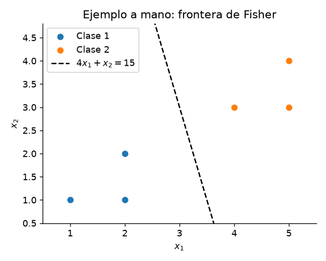
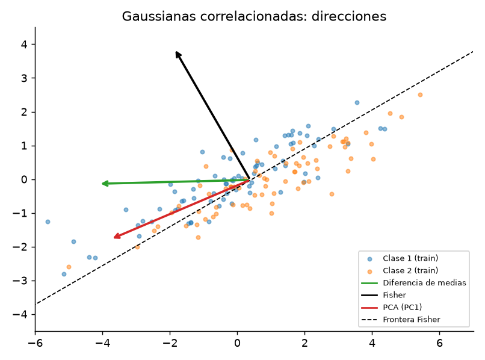
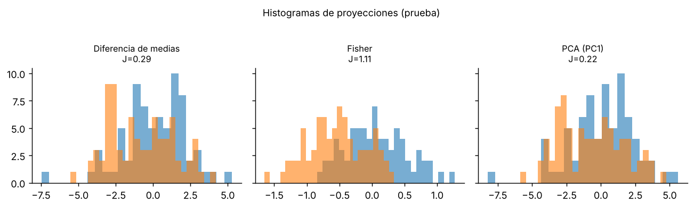
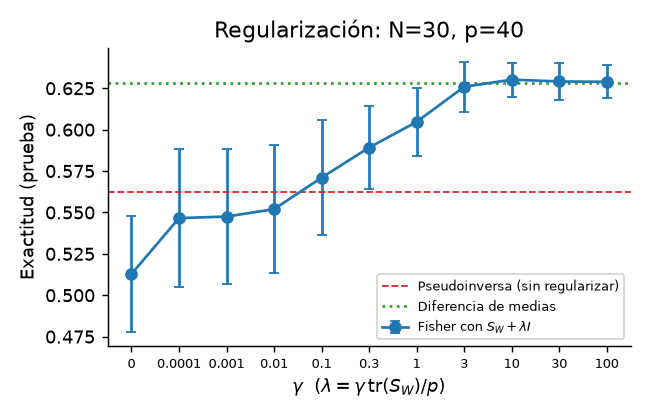

# 1. Problema

Tenemos observaciones $x_i\in\mathbb R^p$ con etiqueta de clase. Queremos una dirección $w\in\mathbb R^p$ tal que, al proyectar $y=w^\top x$, las dos clases queden **lo más separadas posible** y cada clase **lo más compacta posible**. Solo importa la dirección de $w$.

**Objetivo.** Implementar el discriminante de Fisher para dos clases y comprobar que:

1. reproduce el ejemplo a mano ($w\propto(4,1)$, umbral 15, $J=7$);
2. su dirección coincide con la de `LinearDiscriminantAnalysis` de scikit-learn;
3. con datos gaussianos correlacionados, tiene mayor exactitud en prueba que la diferencia de medias y que la primera componente principal, en promedio sobre 10 repeticiones;
4. cuando $S_W$ es singular ($N<p$), regularizar con $S_W+\lambda I$ mejora la exactitud en prueba frente a no regularizar, eligiendo $\lambda$ solo con datos de entrenamiento.

Cada punto se revisa con las pruebas de `tests/` o con las tablas que genera `experiments/run_all.py`.

**Alcance.** Trabajamos el caso de dos clases completo (teoría, código y experimentos). El caso de varias clases se ve en la teoría y en una prueba de rango. Los datos son sintéticos, gaussianos y con la misma covarianza en ambas clases. No incluimos datos reales, covarianzas distintas (QDA) ni clases que no se puedan separar con una recta.

Notación para dos clases $\mathcal C_1,\mathcal C_2$: medias $\mu_k$, dispersiones $S_k=\sum_{x\in\mathcal C_k}(x-\mu_k)(x-\mu_k)^\top$, y dispersión intraclase $S_W=S_1+S_2$. Sea $d=\mu_1-\mu_2$.

**Por qué no basta la distancia entre medias.** Maximizar $(w^\top d)^2$ no tiene máximo (basta escalar $w$) y, aun normalizando $\|w\|=1$, la solución $w\propto d$ ignora la forma de las nubes: si hay correlación, proyectar sobre $d$ puede mezclar las clases.

# 2. Criterio de Fisher

Como $w^\top S_Ww=\sum_k\sum_{x\in\mathcal C_k}(w^\top x-w^\top\mu_k)^2$, el denominador es la dispersión intraclase proyectada. Siguiendo a Fisher [1] (ver también [3], [5]), definimos
$$J(w)=\frac{(w^\top(\mu_1-\mu_2))^2}{w^\top S_Ww},\qquad w\neq 0 .$$

**Propiedades.** (i) $J(cw)=J(w)$ para $c\ne0$: solo cuenta la dirección; en particular $w$ y $-w$ son equivalentes. (ii) $S_W$ es simétrica y semidefinida positiva, pues $w^\top S_Ww$ es una suma de cuadrados $\ge 0$. Supondremos $S_W\succ0$ (se relaja en la sección 6).

# 3. Teorema y demostración

**Teorema.** Si $S_W\succ0$ y $d\neq0$, los maximizadores de $J$ son exactamente $w=c\,S_W^{-1}d$ con $c\neq0$, y
$$\max J = d^\top S_W^{-1}d \quad(\text{distancia de Mahalanobis al cuadrado}).$$

*Demostración.* Como $S_W\succ0$ define un producto interno $\langle u,v\rangle_W=u^\top S_Wv$. Sea $v=S_W^{1/2}w$. Entonces $w^\top d=v^\top S_W^{-1/2}d$ y $w^\top S_Ww=\|v\|^2$, de modo que
$$J=\frac{(v^\top a)^2}{\|v\|^2},\quad a=S_W^{-1/2}d .$$
Por Cauchy–Schwarz, $(v^\top a)^2\le\|v\|^2\|a\|^2$, con igualdad si y solo si $v=ca$. Luego $J\le\|a\|^2=d^\top S_W^{-1}d$ y la igualdad ocurre para $v=cS_W^{-1/2}d$, es decir $w=S_W^{-1/2}v=c\,S_W^{-1}d$. $\blacksquare$

**Casos.** Si $S_W=\sigma^2I$, entonces $w\propto d$ (diferencia de medias): no hay correlación que corregir. Si $d=0$, $J\equiv0$ y no hay dirección preferida. En la práctica resolvemos el sistema $S_Ww=d$ sin calcular $S_W^{-1}$.

# 4. Formulación de Rayleigh y varias clases

Como $(w^\top d)^2=w^\top S_Bw$ con $S_B=dd^\top$ (rango $\le1$),
$$J(w)=\frac{w^\top S_Bw}{w^\top S_Ww},\qquad S_Bw=\lambda S_Ww ,$$
un cociente de Rayleigh *generalizado*. Con $S_W\succ0$, el problema equivale a los autovalores de la matriz simétrica $S_W^{-1/2}S_BS_W^{-1/2}$ (similar a $S_W^{-1}S_B$), y $J$ máximo es el mayor autovalor $\lambda_{\max}$. Aquí $\lambda_{\max}=d^\top S_W^{-1}d$, lo que coincide con el teorema.

Para $K$ clases, con $n_k$, $\mu_k$, media global $\mu$ y $S_B=\sum_k n_k(\mu_k-\mu)(\mu_k-\mu)^\top$, las direcciones son los autovectores generalizados de mayores autovalores [2], [5]. Como $\sum_k n_k(\mu_k-\mu)=0$, $\operatorname{rango}(S_B)\le K-1$; hay a lo sumo $\min\{p,K-1\}$ direcciones útiles (verificado en `test_rank_SB_multiclass`).

# 5. Ejemplo calculable a mano

$\mathcal C_1=\{(1,1),(2,1),(2,2)\}$, $\mathcal C_2=\{(4,3),(5,3),(5,4)\}$.

| Paso | Resultado |
|---|---|
| Medias | $\mu_1=(5/3,4/3)$, $\mu_2=(14/3,10/3)$, $d=(-3,-2)$ |
| Dispersión | $S_1=S_2=\begin{pmatrix}2/3&1/3\\1/3&2/3\end{pmatrix}$, $S_W=\begin{pmatrix}4/3&2/3\\2/3&4/3\end{pmatrix}$ |
| Sistema $S_Ww=d$ | $\begin{pmatrix}4&2\\2&4\end{pmatrix}w=\begin{pmatrix}-9\\-6\end{pmatrix}\Rightarrow w=(-2,-\tfrac12)\propto(4,1)$ |
| Proyección $y=4x_1+x_2$ | $\mathcal C_1\mapsto\{5,9,10\}$, $\mathcal C_2\mapsto\{19,23,24\}$ |
| Medias proyectadas y umbral | $m_1=8$, $m_2=22$, $t=15$ |

Regla: $4x_1+x_2<15\Rightarrow\mathcal C_1$. Además $J_{\max}=d^\top S_W^{-1}d=7$, igual al valor calculado numéricamente. Es una verificación de la teoría, no una medida de generalización, porque se clasifican los mismos puntos con que se ajustó.

{width=55%}

# 6. Singularidad y regularización

$S_W$ tiene rango a lo sumo $\min(p,N-K)$; es singular si $N-K<p$ o hay variables redundantes. Si $d=d_R+d_0$ con $d_R\in\operatorname{im}S_W$, $d_0\in\ker S_W$ y $d_0\ne0$, el cociente no tiene máximo finito (direcciones con dispersión intraclase cero pero separación positiva). Se regulariza:
$$S_{W,\lambda}=S_W+\lambda I,\quad w_\lambda=(S_W+\lambda I)^{-1}d,\quad \lambda=\gamma\,\operatorname{tr}(S_W)/p .$$
Esto maximiza el criterio *modificado* [5]. Para $\lambda$ grande, $w_\lambda$ se aproxima a $d$ (el caso $\sigma^2 I$). Elegimos $\gamma$ solo con validación dentro del entrenamiento.

# 7. Resultados preliminares

Todo es reproducible con `python experiments/run_all.py` (semillas $2026+k$, $k=0,\dots,9$).

**Experimento A: gaussianas correlacionadas.** $\mu_1=(0,0)$, $\mu_2=(1,0)$, $\Sigma=\begin{pmatrix}4&1.8\\1.8&1\end{pmatrix}$ (definida positiva: $\det=0.76$). 150 puntos por clase; división 50 % entrenamiento / 50 % prueba hecha antes del ajuste. Misma regla de umbral (punto medio de medias proyectadas de entrenamiento) para las tres direcciones. $J$ se informa con $S_W$ reemplazada por $\hat\Sigma=S_W/(N-2)$ (así no depende de $N$); el valor poblacional máximo es $\Delta^\top\Sigma^{-1}\Delta=1/0.76\approx1.32$.

| Método | $J$ (train) | Exactitud (prueba) | Ángulo con Fisher |
|---|---|---|---|
| Diferencia de medias | 0.27 ± 0.11 | 0.579 ± 0.034 | 60.1° ± 6.8° |
| **Fisher** | **1.19 ± 0.21** | **0.695 ± 0.032** | 0° |
| PCA (PC1) | 0.20 ± 0.12 | 0.559 ± 0.038 | 83.9° ± 2.8° |

(media ± desv. estándar en 10 repeticiones). Fisher gana en las 10 repeticiones de este escenario. La PC1 apunta a la dirección de máxima varianza (la diagonal de la nube), irrelevante para separar. La dirección de Fisher coincide con `LinearDiscriminantAnalysis` de scikit-learn [4], con `solver="lsqr"` (diferencia $\sim10^{-16}$). Matriz de confusión (repetición 0, fila = real): Fisher $\begin{pmatrix}52&20\\20&58\end{pmatrix}$, diferencia de medias $\begin{pmatrix}44&28\\32&46\end{pmatrix}$, PC1 $\begin{pmatrix}44&28\\35&43\end{pmatrix}$.

{width=60%}

{width=95%}

**Experimento B: pocas muestras y variable redundante.** $p=40$ variables (2 informativas, 1 copia ruidosa de $x_1$, 37 de ruido), solo $N=30$ de entrenamiento y 1000 de prueba; $\mu_2=(1.5,0)$ en las dos primeras. Aquí $\operatorname{rango}(S_W)\le N-2=28<40$: en la repetición 0, $S_W$ tiene 12 autovalores nulos y número de condición $\sim10^{18}$.

| $\gamma$ | 0 | $10^{-4}$ | $10^{-3}$ | $10^{-2}$ | 0.1 | 0.3 | 1 | 3 |
|---|---|---|---|---|---|---|---|---|
| Exactitud media (prueba) | 0.512 | 0.547 | 0.548 | 0.552 | 0.571 | 0.589 | 0.605 | 0.626 |
| Desviación estándar | 0.020 | 0.042 | 0.041 | 0.039 | 0.035 | 0.025 | 0.021 | 0.015 |

Sin regularización ($\gamma=0$), el sistema es numéricamente inestable y obtiene una exactitud media de 0.512, cercana al azar. En la rejilla evaluada, la exactitud media de prueba aumenta hasta 0.626 para $\gamma=3$. Sin embargo, este último valor es descriptivo y no debe utilizarse para seleccionar el parámetro, ya que corresponde al conjunto de prueba.

El parámetro $\gamma$ seleccionado mediante validación cruzada de cinco pliegues, realizada exclusivamente dentro del conjunto de entrenamiento, alcanza una exactitud media de 0.5881 y una desviación estándar de 0.0421 en prueba. Los valores seleccionados variaron entre las diez repeticiones, incluyendo $\gamma=0$, $10^{-4}$, 0.1, 0.3, 1 y 3. Esto evidencia que la selección del parámetro es sensible al tamaño reducido de la muestra de entrenamiento.

{width=50%}

# 8. Limitaciones y trabajo restante

- Los datos son sintéticos y cumplen el supuesto de covarianza común; falta probar covarianzas distintas (donde aparece QDA), clases no separables linealmente y etiquetas ruidosas. **No se concluye que Fisher domine siempre.**
- La rejilla de $\gamma$ termina en 3 y la mayor exactitud descriptiva de prueba se observa en ese extremo. Para la entrega final se ampliará la rejilla y se mantendrá la selección del parámetro mediante validación cruzada dentro del entrenamiento, sin utilizar el conjunto de prueba para elegirlo.
- Para $\gamma=0$ usamos `solve` sobre una matriz casi singular; una comparación con pseudoinversa queda pendiente.
- Pendiente: un conjunto de datos real y el caso multiclase con datos reales.

# 9. Relación con LDA probabilístico

Si $X\mid Y=k\sim\mathcal N(\mu_k,\Sigma)$ con priors $\pi_k$, la regla de Bayes maximiza $\delta_k(x)=x^\top\Sigma^{-1}\mu_k-\tfrac12\mu_k^\top\Sigma^{-1}\mu_k+\log\pi_k$, afín en $x$: fronteras lineales. Para dos clases la normal es $\Sigma^{-1}(\mu_1-\mu_2)$, la misma dirección de Fisher al estimar $\Sigma$ con la covarianza agrupada. Dos motivaciones, una misma dirección [2], [3].

# 10. Organización del equipo y contribuciones

El proyecto se desarrolla de manera colaborativa. Las responsabilidades iniciales se distribuyen de la siguiente manera:

| Integrante | Responsabilidad principal | Actividades |
|---|---|---|
| Elison Sanchez | Fundamentos matemáticos | Formulación del criterio de Fisher, demostración matemática y revisión de la notación. |
| Rodolfo Brandariz | Desarrollo matemático aplicado | Resolución del ejemplo manual, cálculo de matrices de dispersión y explicación de las proyecciones. |
| Marcelo Bravo | Implementación computacional | Desarrollo y revisión del código Python, implementación del algoritmo y comparación con PCA. |
| Marcelo Torres | Experimentación y documentación | Experimentos de regularización, análisis de resultados, gráficos y documentación del repositorio. |

# 11. Cronograma de actividades pendientes
## 12. Cronograma de actividades

| Actividad | Responsable(s) | Fecha límite | Estado |
|---|---|---|---|
| Revisión y corrección matemática | Elison Sanchez y Rodolfo Brandariz | 2/11/2026 | En revisión |
| Verificación de la implementación y pruebas | Marcelo Bravo | 2/11/2026 | En revisión |
| Actualización de experimentos y resultados | Marcelo Bravo y Marcelo Torres | 2/11/2026 | En revisión |
| Interpretación y discusión de resultados | Todos los integrantes | 6/11/2026 | Pendiente |
| Actualización de documentos y referencias | Rodolfo Brandariz y Marcelo Torres | 7/11/2026 | En revisión |
| Preparación y grabación del video | Todos los integrantes | 7/11/2026 | Pendiente |
| Verificación final del repositorio y entrega | Todos los integrantes | 9/11/2026 | Pendiente |

# Referencias

[1] R. A. Fisher, "The use of multiple measurements in taxonomic problems," *Annals of Eugenics*, vol. 7, no. 2, pp. 179–188, 1936, doi: 10.1111/j.1469-1809.1936.tb02137.x.

[2] T. Hastie, R. Tibshirani y J. Friedman, *The Elements of Statistical Learning: Data Mining, Inference, and Prediction*, 2nd ed. New York, NY, USA: Springer, 2009, ch. 4.

[3] C. M. Bishop, *Pattern Recognition and Machine Learning*. New York, NY, USA: Springer, 2006, sec. 4.1.4.

[4] scikit-learn developers, "Linear and Quadratic Discriminant Analysis," *scikit-learn documentation*. [En línea]. Disponible: https://scikit-learn.org/stable/modules/lda_qda.html. [Accedido: 2 nov. 2026].

[5] O. Velásquez Castañón, "Separación de clases con el discriminante de Fisher: proyecciones, cocientes de Rayleigh y clasificación," material de referencia, Álgebra Lineal Aplicada 2026-2, Universidad del Pacífico, Lima, Perú, oct. 2026.
