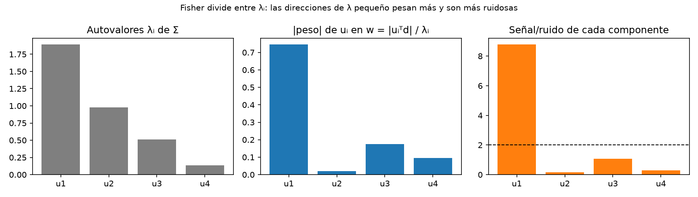
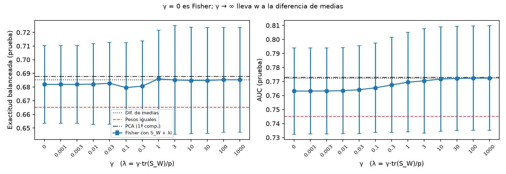
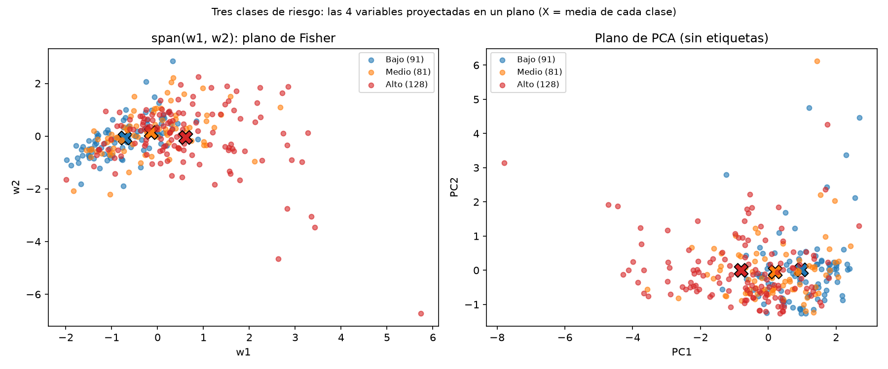

# 1. Problema

Tenemos datos $x_i\in\mathbb R^p$ y sabemos a cuál de dos clases pertenece cada uno. La idea es reemplazar cada dato por un solo número, $y=w^\top x$, eligiendo $w$ de manera que en esa recta las dos clases queden separadas y, a la vez, cada clase quede lo más agrupada posible. Como veremos, lo único que importa es la dirección de $w$, no su tamaño.

**Objetivo.** Nuestro objetivo es programar el discriminante de Fisher para dos clases y comprobar cuatro cosas concretas. Primero, que el código da los mismos valores que el ejemplo hecho a mano ($w\propto(4,1)$, umbral 15 y $J=7$). Segundo, que la dirección que obtenemos es la misma que la de `LinearDiscriminantAnalysis` de scikit-learn. Tercero, que con datos gaussianos correlacionados Fisher acierta más en el conjunto de prueba que la diferencia de medias y que PCA, en promedio sobre 10 repeticiones. Y cuarto, que cuando $S_W$ es singular (más variables que datos) regularizar con $S_W+\lambda I$ mejora el resultado, siempre que $\lambda$ se elija mirando solo el entrenamiento. Todo esto se puede revisar con las pruebas de la carpeta `tests/` y con las tablas que genera `experiments/run_all.py`.

**Alcance.** Hicimos completo el caso de dos clases: la teoría, el código y los experimentos. El caso de más clases solo lo vemos en la teoría y en una prueba sobre el rango de $S_B$. En la entrega parcial todos los datos eran sintéticos, gaussianos y con la misma covarianza en las dos clases. Para la entrega final agregamos un caso con datos reales (sección 8): riesgo de acciones del S&P 500, con dos y con tres clases. No trabajamos con covarianzas distintas (eso llevaría a QDA).

**Conexión con el curso.** Todo el problema se resuelve con herramientas de álgebra lineal:

- proyectar un dato sobre una recta es un **producto interno**, $y=w^\top x$;
- el criterio de Fisher es un cociente de **formas cuadráticas** con matrices **simétricas semidefinidas positivas** ($S_W$ y $S_B$);
- el máximo se demuestra con la **desigualdad de Cauchy–Schwarz** (sección 3);
- calcular $w$ es resolver un **sistema lineal**, $S_Ww=\mu_1-\mu_2$, sin invertir la matriz;
- el caso de varias clases es un **problema de autovalores generalizados**, $S_Bw=\lambda S_Ww$ (sección 4);
- con pocos datos, $S_W$ tiene **rango** menor que $p$, es **singular** y está mal **condicionada**; se corrige con la **regularización** $S_W+\lambda I$ (secciones 6 y 7).

Notación para dos clases $\mathcal C_1,\mathcal C_2$: medias $\mu_k$, dispersiones $S_k=\sum_{x\in\mathcal C_k}(x-\mu_k)(x-\mu_k)^\top$, y dispersión intraclase $S_W=S_1+S_2$. Sea $d=\mu_1-\mu_2$.

**Por qué no basta la distancia entre medias.** Lo primero que se nos ocurre es buscar el $w$ que aleje más las medias proyectadas, es decir, maximizar $(w^\top d)^2$. El problema es que eso no tiene máximo: si duplicamos $w$, el valor se multiplica por cuatro. Podríamos fijar $\|w\|=1$, y entonces la respuesta sería $w\propto d$, pero esa dirección no toma en cuenta la forma de las nubes de puntos. Cuando las variables están correlacionadas, proyectar sobre $d$ puede hacer que las dos clases se encimen.

# 2. Criterio de Fisher

Como $w^\top S_Ww=\sum_k\sum_{x\in\mathcal C_k}(w^\top x-w^\top\mu_k)^2$, el denominador es la dispersión intraclase proyectada. Siguiendo a Fisher [1] (ver también [3], [5]), definimos
$$J(w)=\frac{(w^\top(\mu_1-\mu_2))^2}{w^\top S_Ww},\qquad w\neq 0 .$$

**Propiedades.** Hay dos cosas que conviene notar. La primera es que si multiplicamos $w$ por cualquier $c\ne0$, el numerador y el denominador se multiplican por $c^2$, así que $J(cw)=J(w)$: solo importa la dirección, y por eso $w$ y $-w$ dan lo mismo. La segunda es que $S_W$ es simétrica y semidefinida positiva, porque $w^\top S_Ww$ es una suma de cuadrados y nunca es negativa. Por ahora vamos a suponer que $S_W$ es definida positiva (invertible); en la sección 6 vemos qué pasa cuando no lo es.

# 3. Teorema y demostración

**Teorema.** Si $S_W\succ0$ y $d\neq0$, los maximizadores de $J$ son exactamente $w=c\,S_W^{-1}d$ con $c\neq0$, y
$$\max J = d^\top S_W^{-1}d .$$
Este valor es proporcional a la distancia de Mahalanobis al cuadrado entre las medias: si $\hat\Sigma=S_W/(N-2)$ es la covarianza agrupada, entonces $d^\top S_W^{-1}d=d^\top\hat\Sigma^{-1}d/(N-2)$.

*Demostración.* Como $S_W$ es simétrica, por el teorema espectral se puede escribir $S_W=Q\Lambda Q^\top$, con $Q$ ortogonal y $\Lambda$ diagonal con los autovalores. Como además es definida positiva, todos los autovalores son positivos, así que existe $S_W^{1/2}=Q\Lambda^{1/2}Q^\top$, que también es simétrica, definida positiva e invertible, y cumple $S_W^{1/2}S_W^{1/2}=S_W$. Sea $v=S_W^{1/2}w$. Entonces $w^\top d=v^\top S_W^{-1/2}d$ y $w^\top S_Ww=\|v\|^2$, de modo que
$$J=\frac{(v^\top a)^2}{\|v\|^2},\quad a=S_W^{-1/2}d .$$
Por Cauchy–Schwarz, $(v^\top a)^2\le\|v\|^2\|a\|^2$, con igualdad si y solo si $v=ca$. Luego $J\le\|a\|^2=d^\top S_W^{-1}d$ y la igualdad ocurre para $v=cS_W^{-1/2}d$, es decir $w=S_W^{-1/2}v=c\,S_W^{-1}d$. $\blacksquare$

**Casos.** Si $S_W=\sigma^2I$, entonces $w\propto d$ (diferencia de medias): no hay correlación que corregir. Si $d=0$, $J\equiv0$ y no hay dirección preferida; en ese caso el código lanza un error en lugar de devolver un vector sin sentido. En la práctica resolvemos el sistema $S_Ww=d$ (con `np.linalg.solve`, que usa una factorización LU) en lugar de calcular $S_W^{-1}$ y multiplicar: calcular la inversa hace más operaciones y acumula más error de redondeo, sobre todo cuando $S_W$ está mal condicionada, y no la necesitamos para nada más.

# 4. Formulación de Rayleigh y varias clases

Como $(w^\top d)^2=w^\top S_Bw$ con $S_B=dd^\top$ (rango $\le1$),
$$J(w)=\frac{w^\top S_Bw}{w^\top S_Ww},\qquad S_Bw=\lambda S_Ww .$$
Esto es un cociente de Rayleigh *generalizado*. Si $S_W$ es invertible, podemos hacer el mismo cambio de la demostración, $v=S_W^{1/2}w$, y el problema pasa a ser encontrar los autovalores de la matriz simétrica $S_W^{-1/2}S_BS_W^{-1/2}$. Esta matriz tiene los mismos autovalores que $S_W^{-1}S_B$, porque son semejantes. El valor máximo de $J$ es entonces el autovalor más grande. En el caso de dos clases se puede calcular directamente: como $S_B=dd^\top$ tiene rango 1, la matriz $S_W^{-1}S_B=S_W^{-1}dd^\top$ también tiene rango 1, así que tiene un solo autovalor distinto de cero. Para encontrarlo basta probar con $w=S_W^{-1}d$:
$$S_W^{-1}dd^\top(S_W^{-1}d)=(d^\top S_W^{-1}d)\,S_W^{-1}d ,$$
de modo que $S_W^{-1}d$ es autovector con autovalor $d^\top S_W^{-1}d$. Es justo el máximo y la dirección que obtuvimos en el teorema.

Para $K$ clases, con $n_k$, $\mu_k$, media global $\mu$ y $S_B=\sum_k n_k(\mu_k-\mu)(\mu_k-\mu)^\top$, las direcciones son los autovectores generalizados de mayores autovalores [2], [5]. Como $\sum_k n_k(\mu_k-\mu)=0$, $\operatorname{rango}(S_B)\le K-1$; hay a lo sumo $\min\{p,K-1\}$ direcciones útiles (verificado en `test_rank_SB_multiclass`).

# 5. Ejemplo calculable a mano

$\mathcal C_1=\{(1,1),(2,1),(2,2)\}$, $\mathcal C_2=\{(4,3),(5,3),(5,4)\}$.

| Paso | Resultado |
|---|---|
| Medias | $\mu_1=(5/3,4/3)$, $\mu_2=(14/3,10/3)$, $d=(-3,-2)$ |
| Dispersión | $S_1=S_2=\begin{pmatrix}2/3&1/3\\1/3&2/3\end{pmatrix}$, $S_W=\begin{pmatrix}4/3&2/3\\2/3&4/3\end{pmatrix}$ |
| Sistema $S_Ww=d$ | $\begin{pmatrix}4&2\\2&4\end{pmatrix}w=\begin{pmatrix}-9\\-6\end{pmatrix}\Rightarrow w=(-2,-\tfrac12)\propto(4,1)$ |
| Proyección $y=4x_1+x_2$ | $\mathcal C_1\mapsto\{5,9,10\}$, $\mathcal C_2\mapsto\{19,23,24\}$ |
| Medias proyectadas y umbral | $m_1=8$, $m_2=22$, $t=15$ |

Regla: $4x_1+x_2<15\Rightarrow\mathcal C_1$. Además $J_{\max}=d^\top S_W^{-1}d=7$, igual al valor calculado numéricamente. Es una verificación de la teoría, no una medida de generalización, porque se clasifican los mismos puntos con que se ajustó.

**Por qué el umbral va en el punto medio.** Fisher solo da la dirección $w$; el umbral es una decisión aparte. Usamos el punto medio $t=\tfrac12(w^\top\mu_1+w^\top\mu_2)$ porque es la regla óptima cuando las dos clases son gaussianas con la misma covarianza, tienen la misma probabilidad previa y equivocarse en un sentido cuesta lo mismo que en el otro. En ese caso (sección 10), la regla de Bayes compara $\delta_1(x)-\delta_2(x)=w^\top x-\tfrac12 w^\top(\mu_1+\mu_2)$ con cero, usando $w=\Sigma^{-1}(\mu_1-\mu_2)$; eso es exactamente comparar $w^\top x$ con el punto medio. Si las clases tuvieran probabilidades previas distintas, el umbral se movería en $\log(\pi_2/\pi_1)$.

{width=55%}

# 6. Singularidad y regularización

$S_W$ tiene rango a lo sumo $\min(p,N-K)$; es singular si $N-K<p$ o hay variables redundantes. Si $d=d_R+d_0$ con $d_R\in\operatorname{im}S_W$, $d_0\in\ker S_W$ y $d_0\ne0$, el cociente no tiene máximo finito (direcciones con dispersión intraclase cero pero separación positiva). Se regulariza:
$$S_{W,\lambda}=S_W+\lambda I,\quad w_\lambda=(S_W+\lambda I)^{-1}d,\quad \lambda=\gamma\,\operatorname{tr}(S_W)/p .$$
Escalamos $\lambda$ con $\operatorname{tr}(S_W)/p$, que es el promedio de los autovalores de $S_W$, es decir, la dispersión típica por variable. Así $\gamma$ no tiene unidades: si multiplicamos todos los datos por una constante $c$, $S_W$ y $\operatorname{tr}(S_W)$ se multiplican por $c^2$, $\lambda$ cambia igual y la dirección $w_\lambda$ no cambia. Además, $\gamma$ dice directamente cuánto pesa $\lambda I$ frente a $S_W$: con $\gamma=1$, el término agregado es del mismo tamaño que la dispersión promedio. Hay que tener claro que así ya no se maximiza el criterio original, sino uno modificado [5]. Cuando $\lambda$ es muy grande, el término $\lambda I$ domina sobre $S_W$ y $w_\lambda$ apunta casi en la dirección de $d$, como en el caso $S_W=\sigma^2 I$. El valor de $\gamma$ lo elegimos solo con validación dentro del entrenamiento.

# 7. Resultados con datos sintéticos

Todo es reproducible con `python experiments/run_all.py` (semillas $2026+k$, $k=0,\dots,9$).

**Experimento A: gaussianas correlacionadas.** $\mu_1=(0,0)$, $\mu_2=(1,0)$, $\Sigma=\begin{pmatrix}4&1.8\\1.8&1\end{pmatrix}$ (definida positiva: $\det=0.76$). 150 puntos por clase; división 50 % entrenamiento / 50 % prueba hecha antes del ajuste. Misma regla de umbral (punto medio de medias proyectadas de entrenamiento) para las tres direcciones. Para reportar $J$ usamos $\hat\Sigma=S_W/(N-2)$ en lugar de $S_W$. La razón es que $S_W$ es una suma sobre todos los puntos y crece con $N$, mientras que $\hat\Sigma$ es la covarianza agrupada y no depende del tamaño de la muestra; así el valor se puede comparar con el teórico. Con $\Delta=\mu_1-\mu_2=(-1,0)$, el máximo teórico es $\Delta^\top\Sigma^{-1}\Delta=1/0.76\approx1.32$.

| Método | $J$ (train) | Exactitud (prueba) | Ángulo con Fisher |
|---|---|---|---|
| Diferencia de medias | 0.27 ± 0.11 | 0.579 ± 0.034 | 60.1° ± 6.8° |
| **Fisher** | **1.19 ± 0.21** | **0.695 ± 0.032** | 0° |
| PCA (PC1) | 0.20 ± 0.12 | 0.559 ± 0.038 | 83.9° ± 2.8° |

(media ± desv. estándar en 10 repeticiones). Fisher gana en las 10 repeticiones de este escenario. La PC1 apunta a la dirección de máxima varianza (la diagonal de la nube), irrelevante para separar. La dirección de Fisher coincide con `LinearDiscriminantAnalysis` de scikit-learn [4], con `solver="lsqr"` (diferencia $\sim10^{-16}$). Matriz de confusión (repetición 0, fila = real): Fisher $\begin{pmatrix}52&20\\20&58\end{pmatrix}$, diferencia de medias $\begin{pmatrix}44&28\\32&46\end{pmatrix}$, PC1 $\begin{pmatrix}44&28\\35&43\end{pmatrix}$.

**Comparación con el valor teórico.** Como generamos los datos nosotros, conocemos sus medias y su covarianza verdaderas, y podemos calcular cuánto acertaría cada dirección con infinitos datos. Al proyectar sobre $w$, cada clase sigue siendo normal, con medias separadas por $\delta=|w^\top\Delta|$ y desviación $\sigma=\sqrt{w^\top\Sigma w}$; con el umbral en el punto medio, la exactitud es
$$\Phi\!\left(\frac{\delta}{2\sigma}\right),$$
donde $\Phi$ es la función de distribución de la normal estándar. Para la dirección de Fisher, $\delta/\sigma$ es la distancia de Mahalanobis $\sqrt{\Delta^\top\Sigma^{-1}\Delta}\approx1.147$, y la exactitud es $\Phi(0.574)\approx0.717$, que es la mejor posible con estos datos (la regla de Bayes, sección 10). Para PCA usamos la primera componente de la covarianza total de la mezcla, $\Sigma+\tfrac14\Delta\Delta^\top$.

| Método | Exactitud teórica | Exactitud obtenida | Diferencia |
|---|---|---|---|
| Diferencia de medias | 0.599 | 0.579 | −0.020 |
| **Fisher** (óptimo de Bayes) | **0.717** | **0.695** | −0.022 |
| PCA (PC1) | 0.582 | 0.559 | −0.023 |

Los tres métodos quedan cerca de su valor teórico y en el mismo orden, lo que confirma que los resultados tienen sentido. La lectura importante es que Fisher está a solo 2 puntos del máximo posible: el 30 % que falla no es un defecto del método, sino que las dos clases realmente se superponen. La pequeña diferencia que queda en los tres métodos se explica porque las medias, la covarianza y el umbral se estiman con solo 150 puntos de entrenamiento. Del mismo modo, el $J$ de Fisher en el entrenamiento ($1.19\pm0.21$) queda dentro de una desviación estándar del valor teórico 1.32. Estos valores teóricos los calcula `experiments/run_all.py` (en `results/resumen.json`) y la fórmula se verifica en `test_theoretical_accuracy`.

{width=60%}

{width=95%}

**Experimento B: pocas muestras y variable redundante.** $p=40$ variables (2 informativas, 1 copia ruidosa de $x_1$, 37 de ruido), solo $N=30$ de entrenamiento y 1000 de prueba; $\mu_2=(1.5,0)$ en las dos primeras. Aquí $\operatorname{rango}(S_W)\le N-2=28<40$: en la repetición 0, $S_W$ tiene 12 autovalores nulos y número de condición $\sim10^{18}$.

| $\gamma$ | Exactitud media (prueba) | Desviación estándar |
|---|---|---|
| 0 | 0.513 | 0.035 |
| $10^{-4}$ | 0.547 | 0.041 |
| $10^{-3}$ | 0.548 | 0.041 |
| $10^{-2}$ | 0.552 | 0.039 |
| 0.1 | 0.571 | 0.035 |
| 0.3 | 0.589 | 0.025 |
| 1 | 0.605 | 0.020 |
| 3 | 0.626 | 0.015 |
| 10 | 0.630 | 0.010 |
| 30 | 0.629 | 0.011 |
| 100 | 0.629 | 0.010 |

Como referencia, en las mismas 10 repeticiones medimos también:

| Método de comparación | Exactitud media (prueba) | Desviación estándar |
|---|---|---|
| Pseudoinversa, $w=S_W^{+}d$ (sin regularizar) | 0.562 | 0.027 |
| Diferencia de medias, $w\propto d$ | 0.628 | 0.010 |
| $\gamma$ elegido por validación cruzada | 0.619 | 0.020 |

Sin regularizar ($\gamma=0$), el sistema es numéricamente inestable y la exactitud media es 0.513, prácticamente al azar. Tan inestable que ese valor cambia de una computadora a otra con las mismas versiones de las librerías (0.513 en Linux, 0.511 en Windows), y arrastra consigo al resultado de la validación cruzada cuando alguna repetición elige $\gamma=0$ (0.619 frente a 0.611): con $S_W$ singular el resultado depende del redondeo. `verificar.py` reporta esas celdas como aviso. Las demás filas y todos los otros resultados del proyecto coinciden en cualquier máquina. Por eso agregamos al código un aviso que salta cuando el número de condición de $S_W$ pasa de $10^{12}$. Con la pseudoinversa la exactitud sube a 0.562. Sin embargo, el material del curso [5] advierte que la pseudoinversa no resuelve el criterio original cuando $S_W$ es singular, porque solo escoge una de muchas direcciones posibles; por eso la incluimos únicamente como comparación.

A medida que aumenta $\gamma$, la exactitud sube hasta 0.630 y después se queda casi igual. Esto era de esperar por lo que vimos en la sección 6: con $\lambda$ grande, $w_\lambda$ se acerca a la dirección de $d$, y efectivamente los valores grandes de $\gamma$ dan casi lo mismo que la diferencia de medias (0.628). Nuestra interpretación es que con solo 30 datos $S_W$ queda muy mal estimada, y conviene apoyarse casi solo en las medias. Ojo: estos valores son de prueba y los mostramos solo para describir el comportamiento; no los usamos para elegir $\gamma$.

Cuando elegimos $\gamma$ con validación cruzada de cinco pliegues, usando solo el entrenamiento, la exactitud media en prueba es 0.619 (desviación estándar 0.020). El $\gamma$ elegido cambió bastante de una repetición a otra (desde $10^{-4}$ hasta 100), lo cual tiene sentido: con tan pocos datos, cada pliegue de validación tiene apenas unos 6 puntos y la estimación es ruidosa.

{width=60%}

# 8. Caso aplicado: riesgo de acciones del S&P 500

Hasta aquí todos los datos eran sintéticos. Para la entrega final quisimos ver qué pasa con Fisher en datos reales, donde los supuestos de la teoría (clases gaussianas con la misma covarianza) no se cumplen. Elegimos un problema de finanzas: predecir si una acción va a tener una caída fuerte en el próximo año a partir de lo que hizo en los tres años anteriores. Todo el código está en la carpeta `aplicacion/` y se corre con `python aplicacion/correr_todo.py`; los datos descargados quedaron guardados en `aplicacion/datos/`, así que el análisis se repite sin internet y da siempre los mismos números.

## 8.1 Planteamiento

Tomamos acciones del S&P 500 sin los sectores financiero e inmobiliario (su apalancamiento no se compara con el del resto). Para cada acción calculamos, con precios diarios del 1 de noviembre de 2022 al 1 de noviembre de 2025, un vector $x\in\mathbb R^4$:

| Variable | Qué mide | Cómo se calcula |
|---|---|---|
| $\sigma$ | volatilidad anual | desviación estándar de los retornos diarios $\times\sqrt{252}$ |
| $\beta$ | sensibilidad al mercado | $\operatorname{Cov}(r_{\text{acción}},r_{\text{S\&P}})/\operatorname{Var}(r_{\text{S\&P}})$ |
| MDD | caída máxima pasada | mayor caída porcentual desde un máximo previo en la ventana |
| $\log(1+D/E)$ | apalancamiento | deuda total entre patrimonio, último balance anual antes de la ventana; el logaritmo corrige la asimetría (hay valores desde 0 hasta 99) |

La etiqueta se calcula con el año **siguiente**: una acción es *riesgosa* (clase 2) si entre el 1 de noviembre de 2025 y el 1 de noviembre de 2026 su caída máxima superó 30 %, y *no riesgosa* (clase 1) en otro caso. Las variables se estandarizan con la media y la desviación del entrenamiento.

El conjunto de entrenamiento tiene 300 acciones (172 no riesgosas y 128 riesgosas), elegidas sin mirar la etiqueta: una lista inicial fija de 90 y el resto del índice en orden aleatorio con semilla fija. Las 40 acciones de la validación externa son las siguientes de esa misma cola, así que el modelo nunca las vio. Para que el resultado no dependa de Yahoo Finance, que corrige datos con el tiempo, las dos listas quedaron guardadas en CSV.

Comparamos cinco reglas. Las cuatro primeras usan un puntaje $w^\top x$ y el umbral del punto medio (sección 5), y solo cambia la dirección: Fisher, PCA (primera componente), diferencia de medias y pesos iguales ($w=(1,1,1,1)/2$). La quinta es una regla de persistencia sin entrenamiento: riesgosa si la caída máxima pasada ya superó 30 %. En este caso usamos $d=\mu_2-\mu_1$ y orientamos $w$ para que un puntaje alto signifique más riesgo; es la misma dirección de `src/fisher.py` con el signo cambiado, y como $J(-w)=J(w)$ no cambia nada (lo comprueba `tests/test_aplicacion.py`).

## 8.2 Resultados

**Validación interna.** Repetimos 20 veces una separación estratificada 70 % entrenamiento / 30 % prueba.

| Dirección | Exactitud (prueba) | Exactitud balanceada | Ángulo con Fisher |
|---|---|---|---|
| Fisher | 0.696 ± 0.026 | 0.682 | 0° |
| PCA (PC1) | 0.698 ± 0.036 | 0.688 | 21.9° |
| Diferencia de medias | 0.696 ± 0.036 | 0.685 | 18.6° |
| Siempre la clase mayoritaria | 0.578 | | |

Los tres métodos le ganan a la línea base por unos 12 puntos, pero entre ellos no hay diferencia. La dirección de Fisher coincide con la de scikit-learn (coseno igual a 1). Los pesos de Fisher sobre las variables estandarizadas son $(0.72,\ 0.61,\ 0.31,\ -0.13)$: casi todo el peso va a $\sigma$ y $\beta$.

**Validación externa.** Entrenamos con las 300 acciones y clasificamos las 40 nuevas (17 no riesgosas y 23 riesgosas) una sola vez, sin ajustar nada después de ver el resultado.

| Regla | Aciertos | Exactitud | Riesgosas detectadas | AUC |
|---|---|---|---|---|
| Fisher | 25 / 40 | 0.625 | 16 / 23 | 0.62 |
| PCA (PC1) | 25 / 40 | 0.625 | 16 / 23 | 0.61 |
| Diferencia de medias | 25 / 40 | 0.625 | 16 / 23 | 0.61 |
| Pesos iguales | 25 / 40 | 0.625 | 15 / 23 | 0.65 |
| Persistencia | 25 / 40 | 0.625 | 19 / 23 | |
| Siempre la clase mayoritaria | 23 / 40 | 0.575 | | |

Las cinco reglas aciertan exactamente 25 de 40, y Fisher, PCA y diferencia de medias dan la misma matriz de confusión, $\begin{pmatrix}9&8\\7&16\end{pmatrix}$. Fisher no gana. El resto de esta sección explica por qué, y es el aporte de Marcelo Torres al proyecto.

## 8.3 Por qué Fisher no gana aquí: descomposición espectral de $w$

Sea $\hat\Sigma=S_W/(N-2)$ la covarianza agrupada. Por el teorema espectral, $\hat\Sigma=U\Lambda U^\top$ con autovectores ortonormales $u_i$ y autovalores $\lambda_1\ge\dots\ge\lambda_4>0$. Entonces $\hat\Sigma^{-1}=U\Lambda^{-1}U^\top$ y la dirección de Fisher se puede escribir como una suma sobre los autovectores:
$$w=\hat\Sigma^{-1}d=\sum_{i=1}^{4}\frac{u_i^\top d}{\lambda_i}\,u_i .$$
Cada autodirección entra con peso $u_i^\top d/\lambda_i$: Fisher **divide entre el autovalor**, así que da más importancia a las direcciones en las que la dispersión dentro de las clases es pequeña. Eso es exactamente lo que lo hacía ganar en el experimento A, donde la separación estaba en la dirección de menor varianza.

El problema es que $d$ no es la diferencia de medias verdadera sino una estimación con $N_1$ y $N_2$ datos, y su error tiene covarianza aproximada $k\hat\Sigma$ con $k=1/N_1+1/N_2$. En la dirección $u_i$ ese error tiene desviación $\sqrt{k\lambda_i}$, y al dividirlo entre $\lambda_i$ queda $\sqrt{k/\lambda_i}$: **las direcciones de autovalor pequeño amplifican el ruido**. Por eso medimos para cada componente la razón señal/ruido $|u_i^\top d|/\sqrt{k\lambda_i}$.

| Componente | $\lambda_i$ | $u_i^\top d$ | Peso en $w$ | % de $\|w\|^2$ | Señal/ruido |
|---|---|---|---|---|---|
| $u_1$ | 1.89 | −1.41 | −0.75 | 93.3 | 8.8 |
| $u_2$ | 0.98 | 0.02 | 0.02 | 0.1 | 0.2 |
| $u_3$ | 0.51 | −0.09 | −0.17 | 5.1 | 1.1 |
| $u_4$ | 0.14 | −0.01 | −0.10 | 1.5 | 0.3 |

La lectura es clara. Las tres variables de mercado están muy correlacionadas (0.80 entre $\sigma$ y $\beta$, 0.69 entre $\sigma$ y MDD), así que $u_1\approx(-0.61,-0.56,-0.53,0.19)$ es "riesgo general" y concentra el 93 % de $w$ con señal/ruido 8.8. Las otras tres direcciones tienen señal/ruido menor que 1.1: no separan las clases, pero Fisher igual las mete en $w$ divididas entre autovalores pequeños. Lo que Fisher agrega respecto a la diferencia de medias es, en su mayor parte, ruido. En el experimento A pasaba lo contrario: la dirección de autovalor pequeño tenía señal grande, y la división entre $\lambda$ era justo lo que hacía falta.

{width=100%}

## 8.4 Camino de regularización

Regularizar con $\hat\Sigma+\lambda I$ reemplaza $1/\lambda_i$ por $1/(\lambda_i+\lambda)$ en la suma anterior: aplasta justo los términos ruidosos. Con $\gamma=0$ tenemos Fisher y con $\gamma\to\infty$ todos los denominadores se igualan y $w\to d$. Recorrimos $\gamma$ de 0 a 1000 en las mismas 20 particiones de la validación interna.

| $\gamma$ | 0 | 0.1 | 1 | 10 | 1000 | Dif. de medias |
|---|---|---|---|---|---|---|
| Exactitud balanceada | 0.682 | 0.680 | 0.686 | 0.685 | 0.685 | 0.685 |
| AUC | 0.763 | 0.765 | 0.769 | 0.772 | 0.772 | 0.772 |
| Ángulo con $d$ | 18.6° | 13.6° | 4.9° | 0.7° | 0.0° | 0° |

La exactitud no se mueve mientras $w$ gira 18.6° hasta coincidir con $d$. Es el mismo mecanismo del experimento B, pero con otro efecto: allí regularizar subía la exactitud de 51 % a 63 % porque $S_W$ era singular; aquí $S_W$ está bien condicionada (número de condición 13.8) y regularizar no cuesta ni gana nada, lo que confirma que las direcciones de autovalor pequeño no aportaban.

{width=100%}

## 8.5 Dirección y umbral por separado

Un clasificador lineal toma dos decisiones: la dirección $w$, que es lo que Fisher optimiza, y el umbral $t$. La exactitud mezcla las dos. El AUC (área bajo la curva ROC) mide solo la dirección: es la probabilidad de que una acción riesgosa tenga puntaje $w^\top x$ mayor que una no riesgosa, para cualquier umbral. En la validación interna los AUC son 0.763 (Fisher), 0.773 (PCA), 0.772 (diferencia de medias) y 0.745 (pesos iguales): las direcciones son casi igual de buenas.

Con solo 40 acciones de prueba, además, el intervalo de confianza de Wilson al 95 % para 25 aciertos va de 47 % a 76 %. Una exactitud de 62.5 % no se distingue de 70 %, y la prueba exacta de McNemar entre Fisher y cada método da $p=1$: ninguna diferencia es distinguible del azar. Una corrida anterior con 110 acciones de entrenamiento daba pesos iguales 70 % y Fisher 60 %; con 300 acciones esa diferencia desapareció, como anticipa el intervalo.

## 8.6 Estabilidad de los pesos

Para ver qué tan confiable es $w$, remuestreamos las 300 acciones 1000 veces (bootstrap) y recalculamos cada dirección. La mediana del ángulo entre la $w$ de cada remuestra y la de todos los datos es 23.5° para Fisher (percentil 95: 42.8°), 2.3° para PCA y 4.7° para la diferencia de medias. En Fisher, el signo del peso de MDD cambia en el 11 % de las remuestras y el de $\log(1+D/E)$ en el 24 %, así que no se pueden interpretar; en los otros dos métodos todos los signos son estables. Es la misma historia de la sección 8.3 vista desde otro lado: Fisher es el método que más depende de las direcciones ruidosas, y por eso es el más inestable.

## 8.7 Tres clases y el plano $\operatorname{span}(w_1,w_2)$

Para ver en dos dimensiones lo que pasa en $\mathbb R^4$ usamos el caso multiclase de la sección 4 con tres niveles de riesgo según la caída del año siguiente: bajo ($\le20$ %, 91 acciones), medio (81) y alto ($>30$ %, 128). Como $\operatorname{rango}(S_B)=K-1=2$ (lo verifica el código), el problema $S_Bw=\lambda S_Ww$ tiene solo dos autovalores no nulos, 0.320 y 0.007, y sus autovectores $w_1,w_2$ generan el plano donde las tres clases quedan lo más separadas posible, sin elegirlo a mano. Casi toda la separación está en $w_1\approx(0.55,0.69,0.44,-0.16)$, otra vez "riesgo general". Clasificando por el centroide más cercano en ese plano, la exactitud balanceada en prueba es 0.489 ± 0.031 (azar: 0.333), igual que en el plano de PCA (0.494 ± 0.035).

{width=100%}

## 8.8 Qué aprendimos y limitaciones

En datos sintéticos Fisher llega casi al óptimo de Bayes; en acciones reales empata con la diferencia de medias. No es que el método falle: la descomposición espectral muestra que aquí la separación entre clases y la dispersión interna apuntan en la misma dirección, así que corregir con $S_W^{-1}$ no aporta nada y solo amplifica el ruido de las direcciones pequeñas. Regularizar lo corrige sin costo, y con 40 acciones de prueba ningún método se puede declarar mejor. Fisher conviene cuando hay una dirección de poca varianza con mucha señal (experimento A); cuando no la hay, la diferencia de medias regularizada hace lo mismo con menos riesgo.

Limitaciones del caso aplicado: (i) sesgo de supervivencia, porque usamos la lista actual del índice y faltan las empresas que salieron, probablemente las más riesgosas; (ii) el balance con que se calcula $D/E$ se publica dos o tres meses después del cierre, así que no siempre era público al inicio del año de la etiqueta; (iii) se descartan las empresas con patrimonio negativo; (iv) un solo año de etiqueta y un solo umbral de 30 %, y una acción con $D/E\approx99$ aparece como valor atípico en el plano de tres clases.

# 9. Limitaciones y trabajo restante

- Los datos sintéticos cumplen el supuesto de covarianza común; no probamos covarianzas distintas (donde aparece QDA) ni etiquetas ruidosas. **No se concluye que Fisher domine siempre.** De hecho, en el caso aplicado no gana.
- En el experimento B el mejor desempeño se parece al de la diferencia de medias, así que con $N<p$ la ventaja de Fisher depende de cuánta regularización se use.
- El caso real tiene sus propias limitaciones (sección 8.8): sesgo de supervivencia, fecha de publicación del balance, un solo año de etiqueta y una prueba externa de solo 40 acciones.
- Los dos pendientes de la entrega parcial (un conjunto de datos real y el caso multiclase con datos reales) quedaron cubiertos en las secciones 8.1 a 8.6 y 8.7.

# 10. Relación con LDA probabilístico

Si $X\mid Y=k\sim\mathcal N(\mu_k,\Sigma)$ con priors $\pi_k$, la regla de Bayes maximiza $\delta_k(x)=x^\top\Sigma^{-1}\mu_k-\tfrac12\mu_k^\top\Sigma^{-1}\mu_k+\log\pi_k$, Esta función es afín en $x$, así que las fronteras entre clases son rectas (o hiperplanos). Para dos clases, el vector normal a la frontera es $\Sigma^{-1}(\mu_1-\mu_2)$. Si estimamos $\Sigma$ con la covarianza agrupada, que es proporcional a $S_W$, obtenemos la misma dirección que con el criterio de Fisher. Es decir, partiendo de una idea geométrica (Fisher) y de una probabilística (Bayes) se llega al mismo resultado [2], [3].

# 11. Organización del equipo y contribuciones

Cada integrante se encargó de las siguientes partes del proyecto:

| Integrante | Responsabilidad principal | Actividades |
|---|---|---|
| Elison Sanchez | Fundamentos matemáticos | Formulación del criterio de Fisher, demostración matemática y revisión de la notación. En la entrega final: planteamiento del caso aplicado, descarga y construcción del conjunto de acciones, validación interna y externa (secciones 8.1 y 8.2). |
| Rodolfo Brandariz | Desarrollo matemático aplicado | Resolución del ejemplo manual, cálculo de matrices de dispersión y explicación de las proyecciones. |
| Marcelo Bravo | Implementación computacional | Desarrollo y revisión del código Python, implementación del algoritmo y comparación con PCA. |
| Marcelo Torres | Experimentación y documentación | Experimentos de regularización, análisis de resultados, gráficos y documentación del repositorio. En la entrega final: integración del caso aplicado al repositorio y análisis de por qué Fisher no gana en datos reales (descomposición espectral, camino de regularización, AUC, bootstrap y tres clases, secciones 8.3 a 8.7). |

# 12. Cronograma de actividades

**Hasta la entrega parcial (4 de noviembre de 2026)**

| Actividad | Responsable(s) | Fecha | Estado |
|----------------------------|--------------|----------|--------|
| Formulación del criterio, demostración y revisión de la notación | Elison Sanchez | Antes del 4/11/2026 | Completado |
| Ejemplo a mano, matrices de dispersión y proyecciones | Rodolfo Brandariz | Antes del 4/11/2026 | Completado |
| Implementación en Python, pruebas y comparación con PCA | Marcelo Bravo | Antes del 4/11/2026 | Completado |
| Experimentos de regularización, análisis de resultados y gráficos | Marcelo Torres | Antes del 4/11/2026 | Completado |
| Documentación del repositorio, referencias y guion del video | Rodolfo Brandariz y Marcelo Torres | Antes del 4/11/2026 | Completado |
| Presentación de la entrega parcial (etiqueta `avance-parcial`) | Todos los integrantes | 4/11/2026 | En curso |

**Hasta la entrega final** (la fecha se confirmará en Blackboard)

| Actividad | Responsable(s) | Estado |
|-----------------------------------|-------------|---------|
| Caso aplicado con datos reales: planteamiento, datos y validaciones | Elison Sanchez | Completado |
| Integrar el caso aplicado al repositorio (carpeta `aplicacion/`, datos guardados, pruebas) | Marcelo Torres | Completado |
| Análisis de por qué Fisher no gana en datos reales y caso de tres clases | Marcelo Torres | Completado |
| Actualizar el documento, el README y el guion con el caso aplicado | Marcelo Torres | Completado |
| Preparar las diapositivas y figuras del video | Todos los integrantes | Pendiente |
| Grabar el video, cada uno su parte del guion | Rodolfo Brandariz coordina; todos | Pendiente |
| Revisión final del repositorio y etiqueta `entrega-final` | Rodolfo Brandariz y Marcelo Torres | Pendiente |
| Preparar la ronda de preguntas (repasar todo el proyecto) | Todos los integrantes | Pendiente |

# Referencias

[1] R. A. Fisher, "The use of multiple measurements in taxonomic problems," *Annals of Eugenics*, vol. 7, no. 2, pp. 179–188, 1936, doi: 10.1111/j.1469-1809.1936.tb02137.x.

[2] T. Hastie, R. Tibshirani y J. Friedman, *The Elements of Statistical Learning: Data Mining, Inference, and Prediction*, 2nd ed. New York, NY, USA: Springer, 2009, ch. 4.

[3] C. M. Bishop, *Pattern Recognition and Machine Learning*. New York, NY, USA: Springer, 2006, sec. 4.1.4.

[4] scikit-learn developers, "Linear and Quadratic Discriminant Analysis," *scikit-learn documentation*. [En línea]. Disponible: https://scikit-learn.org/stable/modules/lda_qda.html. [Accedido: 2 nov. 2026].

[5] O. Velásquez Castañón, "Separación de clases con el discriminante de Fisher: proyecciones, cocientes de Rayleigh y clasificación," material de referencia, Álgebra Lineal Aplicada 2026-2, Universidad del Pacífico, Lima, Perú, oct. 2026.
